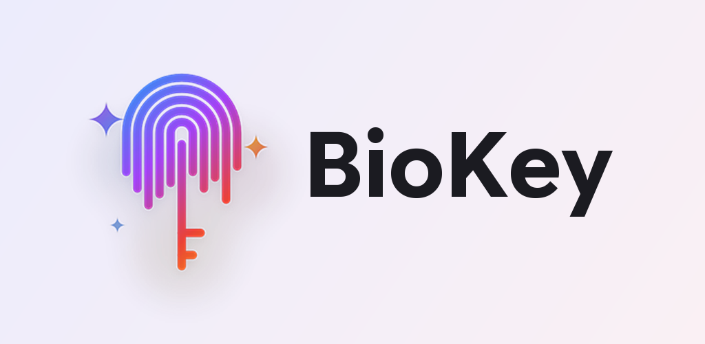
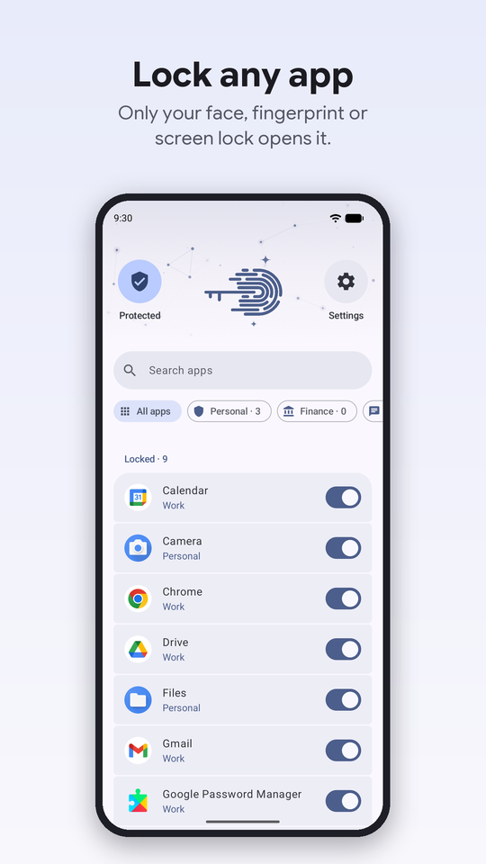
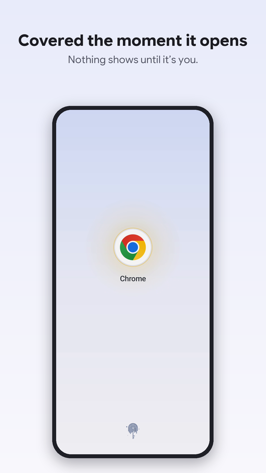
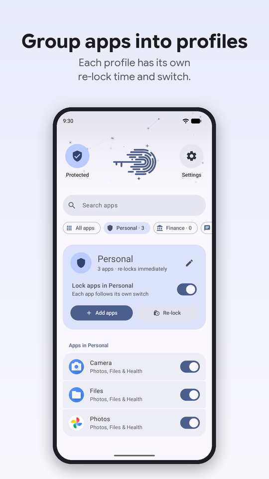
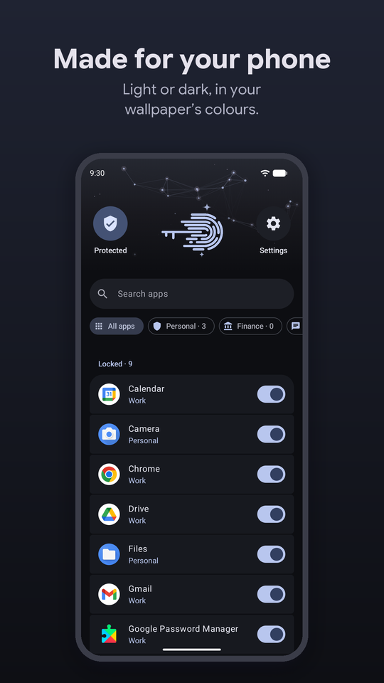

# BioKey



An app lock for Android, modelled on Android 17’s own App lock: the apps you choose open only after your face, fingerprint or screen lock, and stay unlocked while you’re using them. No internet access, no data collected.

**[Get it on Google Play](https://play.google.com/store/apps/details?id=com.nbdesigns.biokey)** · [Privacy policy](https://peacetothemountain.github.io/BioKey/privacy/) · [Support](https://peacetothemountain.github.io/BioKey/support/)

[-3DDC84?logo=android&logoColor=white)](https://developer.android.com)
[](https://kotlinlang.org)
[](https://developer.android.com/jetpack/compose)
[](LICENSE)

<p align="center">
  
  
  
  
</p>

---

## Contents

- [Features](#features)
- [How it works](#how-it-works)
- [Permissions](#permissions)
- [Privacy](#privacy)
- [Limits](#limits)
- [Building from source](#building-from-source)
- [Testing](#testing)
- [Project layout](#project-layout)
- [Support and contact](#support-and-contact)
- [License](#license)

## Features

- **Lock the apps you choose** behind your face or fingerprint, or your PIN, pattern or password. Only faces and fingerprints Android rates as strong are accepted.
- **Covered at the tap.** With the accessibility engine, a locked app is covered the moment you tap it, before it draws anything.
- **Stays unlocked while you use it,** and locks again when you leave: at once, after a delay you choose, or when the phone locks. Whenever the phone locks, every locked app locks with it.
- **Profiles** (Personal, Finance, Social and Work, or your own), each with its own re-lock delay and on/off switch. Auto-sort locks the apps it recognises and puts each in one.
- **Face or fingerprint only** (optional): your PIN no longer opens locked apps or BioKey. If someone adds their own fingerprint in Android’s settings, BioKey tells you. An optional **passphrase** of your own covers a wet finger or a locked-out sensor.
- **Proof of a match:** each unlock must be signed by a key in the phone’s secure hardware, which signs only straight after checking you.
- **Security activity:** optional failed unlock alerts, and a record of any time protection was off, a face or fingerprint was added, or protection was weakened.
- **Re-lock now** locks every unlocked app at once, from the app, a Quick Settings tile or BioKey’s icon. **Lock this app** locks the app you’re in from Quick Settings.
- **Pause** for 15 minutes, 1 hour or until you resume, with a notification that says so.
- **New and reinstalled apps:** an offer to lock each new app, and a locked app reinstalled within 30 days is locked again.
- **What locking does:** the first time you lock an app, BioKey says plainly what a lock doesn’t cover (notifications, widgets, other apps with access to the same data).
- **BioKey locks itself,** and works under Android’s Advanced Protection through compatibility mode.
- **Password-protected backup** of your setup.
- **No `INTERNET` permission.** Nothing leaves the phone unless you save or share it yourself.

Requires Android 12 or later.

## How it works

1. **Covering.** BioKey watches which app is opening, with one of [two engines](#two-engines). When a locked app opens or appears (split screen and picture-in-picture included), BioKey covers it at once with an opaque, screenshot-proof cover that matches the app’s own launch screen, so there’s no flash.
2. **Checking it’s you.** A lock screen takes over from the cover and shows Android’s `BiometricPrompt`. Android’s word that it matched isn’t enough on its own (see [Proof of a match](#proof-of-a-match)). If Android won’t show the lock screen or cover, the app is sent Home rather than left open.
3. **Staying unlocked.** An unlocked app stays unlocked while it’s on screen, whatever happens inside it. Once it’s gone, it locks again after its re-lock delay. A quick trip to a helper app (an authenticator, email, a photo or file picker, the camera, Settings, a Play Store page, a call) and back within 5 minutes doesn’t lock it. Helpers count only if they came with the phone or from a trusted app store, so an app can’t pass itself off as one.

When the phone locks, everything locks: as the screen goes off, or later if Android’s own lock delay or Smart Lock keeps the phone unlocked meanwhile. A screensaver, Lockdown and **Re-lock now** lock everything at once.

### Proof of a match

Each unlock prompt (and each face or fingerprint check before a change in BioKey) gets a fresh random challenge to sign with an EC P-256 key in the Android Keystore (`biokey_unlock_proof`). The hardware lets that key sign only straight after it has checked you (`BiometricPrompt.CryptoObject`), so a match reported without a valid signature opens nothing. Code: `core/security/UnlockProof.kt`.

- **Never a lockout.** Where the key can’t be made or used, or its signatures fail twice in a row, BioKey takes Android’s word for an hour, then asks for the signature again, and records it in Security activity.
- **With a passphrase standing in** (“Face or fingerprint only” on and a passphrase set), there’s no fallback: a match the hardware can’t prove never opens anything, and the passphrase is there instead.
- Removing the screen lock destroys the key; BioKey makes a new one once there’s a screen lock again. It’s no defence on a rooted phone (see [Limits](#limits)).

### The passphrase

Optional, and only used while “Face or fingerprint only” is on. It belongs to BioKey alone, so knowing the screen lock isn’t enough. It’s at least 8 characters, typed on BioKey’s own cover with no autofill or suggestions, and stored only as a check value (PBKDF2-HMAC-SHA512, 210,000 rounds, random salt, then mixed with a Keystore key so it can’t be tested off the phone), never in a backup. Wrong tries in a row mean a wait (30 seconds from the 5th, 5 minutes from the 8th, 30 minutes from the 10th) that a restart or a date change can’t shorten. Setting, changing or removing it is always recorded, and waits a day after a face or fingerprint change, so someone with your PIN can’t add a fingerprint, set a passphrase and remove the fingerprint unseen.

### Security activity

BioKey records, and tells you at your next unlock:

- times protection was off (switched off or force-stopped), and BioKey’s storage being cleared;
- a face or fingerprint added or removed (it can’t be cleared, only aged out; for a day after, nothing that clears or silences records can be done);
- the phone having no screen lock;
- a face or fingerprint that couldn’t be used under “Face or fingerprint only”, or a match the hardware couldn’t prove;
- the passphrase set, changed or removed;
- changes that weaken protection made after BioKey was opened with the screen lock rather than a face or fingerprint;
- with failed unlock alerts on, faces, fingerprints and passphrases that didn’t match, and optionally every locked app opened with the screen lock.

Records are kept until you’ve seen them, and for 7 days after. Changing the phone’s date can’t hide or delete them.

### Two engines

| | Accessibility engine (default) | Compatibility mode |
|---|---|---|
| **Used when** | The accessibility service is on | Accessibility is unavailable, e.g. under Android 17’s Advanced Protection |
| **Sees** | Which app is on screen and its windows’ titles; the label of what you tap on the home screen, in search or in Recents; Android’s own App lock prompt while it’s up | Which app was just opened (usage access) |
| **Covers** | From the tap, before the app has a window | As the app opens, checking every 0.15 seconds |
| **Extra** | | A low-priority notification while running (required by Android) |

BioKey switches between them by itself. It never claims to be an accessibility tool: Google Play rejects that and Play Protect blocks it.

### Android 17’s own App lock

Android 17 QPR3 adds a native App lock, but turning it on needs `LOCK_APPS`, which only the default launcher can hold, so BioKey can’t use it. An app can be locked in both: the accessibility engine recognises Android’s prompt, and when it can be sure which app it was for, counts that unlock so you’re asked once. Otherwise (compatibility mode, an ambiguous name, “Face or fingerprint only” or failed unlock alerts on) BioKey asks too. Apps Android locks as well are marked “Also locked by Android”.

## Permissions

| Permission | Why |
|---|---|
| Accessibility service | Sees which app is on screen and covers locked apps. Reads the label of what you tap on the home screen, in search or in Recents; app names on Recents cards while a locked app is unlocked; window titles; and Android 17’s App lock prompt while it’s up. Doesn’t read what you type. |
| `USE_BIOMETRIC` | Checking your face or fingerprint, through Android’s prompt. |
| `HIDE_OVERLAY_WINDOWS` | Hides other apps’ overlays over BioKey’s screens. |
| `POST_NOTIFICATIONS` | Protection alerts, Security activity (never naming the app, never on the lock screen), new-app offers, and “Protection is paused”. |
| `RECEIVE_BOOT_COMPLETED` | After a restart, starts compatibility mode if it’s in use, or warns if protection is off. |
| `QUERY_ADVANCED_PROTECTION_MODE` | Detects Advanced Protection, to switch to compatibility mode. |
| Usage access, display over other apps, `FOREGROUND_SERVICE`, `FOREGROUND_SERVICE_SPECIAL_USE` | Compatibility mode only. |

Package visibility is limited to launchable apps and the kinds BioKey needs to recognise (launchers, keyboards, photo and file pickers, cameras, the lock screen’s shortcuts, Google Play services, Credential Manager, Settings); no `QUERY_ALL_PACKAGES`. Also absent: `INTERNET`, a battery-optimisation exemption, `VIBRATE`.

BioKey stays within Google Play’s rules: an honest accessibility declaration (`isAccessibilityTool="false"`), a prominent disclosure before each sensitive permission (only **Agree** continues), and no blocking of uninstall in the Play version. A build installed from a file has to be allowed restricted settings first (see [Support](https://peacetothemountain.github.io/BioKey/support/)).

## Privacy

BioKey collects no data: no internet access, no analytics, no ads, no third-party services. Your locked apps, profiles, settings, Security activity and a short diagnostic log stay in its private storage, excluded from cloud backup and device transfer. Nothing leaves the phone unless you save a backup file or share the diagnostic log yourself.

Full policy: [peacetothemountain.github.io/BioKey/privacy](https://peacetothemountain.github.io/BioKey/privacy/) (source: [PRIVACY.md](PRIVACY.md)).

## Limits

An app lock running as a regular app can’t defend against everything:

- **Root, ADB or a modified OS** can bypass any app lock, the proof of a match included.
- **Before the first unlock after a restart,** and in **safe mode,** BioKey can’t run, so nothing is covered.
- **Compatibility mode** covers a locked app a little later than the accessibility engine: an app still in memory can show for about half a second. It can’t see apps in Android’s work profile, read window titles, see apps closed from Recents, or cover only half a split screen. It needs both its permissions, and after a restart starts only once Android says start-up has finished.
- **Launches without a tap** (links, notifications, the quick-switch gesture) are covered when Android reports the window, which on a cold start can take up to about half a second. A launcher’s search result can show for a frame or two.
- **Apps that hide their windows from accessibility services** (many banking apps) are covered when opened from their icon or Recents card, but can open uncovered another way. BioKey goes by their window title where it names exactly one app, which another app hiding its windows could copy.
- **Apps that hide other apps’ overlays** can show for a moment before the lock screen in compatibility mode.
- **Recents previews** of a locked app can’t be blanked; only Android’s own App lock can do that.
- **Home screens** can’t be locked, so you can always get Home.
- **Helper apps can’t be told from a switch you make yourself:** going straight to the camera, a picker, messages or an authenticator and back within 5 minutes keeps an app unlocked. Lock the phone or use **Re-lock now** before handing it over.
- **Going Home and straight back within 0.4 seconds** keeps an app unlocked, since Android’s window list can briefly leave out an app still on screen.
- **Picture-in-picture, split screen and other displays** are covered by patches, which can show the window for a moment after an unlock or while it’s moved.
- **Notifications, widgets and data:** a lock covers the app, not what it posts, its home-screen widgets, or other apps that can read the same photos, files or messages. A locked app’s own screensaver shows without a check.
- **Waking or unfolding the phone** can show the last frame of an app for a moment before the keyguard draws, for any app.
- **Someone who knows your screen lock** can add their own face or fingerprint. BioKey can’t prevent it, but records it, and the record can’t be cleared.
- **Clearing BioKey’s storage** deletes every lock and record, and Android switches its accessibility service off. BioKey records the reset once it’s set up again.
- **Faces and fingerprints removed:** Android says when the last one goes, not one of several.
- **A force stop** stops BioKey’s reminders until it runs again; before Android 15 a stop followed by a restart can go unrecorded.
- **An accessibility shortcut** assigned to BioKey switches it off with no check. BioKey’s settings warn while one is assigned.
- **Android 12 and 13** can’t hide BioKey’s screens from other accessibility services you’ve turned on.
- **Self-protection** (not in the Play version) recognises Settings screens by their content, and is tested on Pixel layouts.

### Deliberate choices

- **No intruder photos.** That needs the camera and photographs people who never agreed to it. BioKey records which app and when, nothing about who.
- **No BioKey PIN in place of the phone’s.** BioKey uses the phone’s own face, fingerprint and screen lock. Its only secret of its own, the passphrase, is optional.
- **English only.** Strings shown outside BioKey are in `strings.xml`, ready for translation.
- **The diagnostic log is on by default.** With no network access, it’s the only way to trace a missed lock. It stays on the phone, keeps 3 days, names only locked apps, and leaves only when you share it.

## Building from source

Requirements: JDK 17 and the Android SDK (compileSdk 37.2; Gradle downloads it if missing). The unit tests run on Java 21, which Gradle also downloads.

The app ID is `com.nbdesigns.biokey`; the Kotlin package is `com.android.BioKey`.

```bash
./gradlew :app:assembleDebug
adb install -r app/build/outputs/apk/debug/app-debug.apk
```

On Android 13 and later, an APK installed from a file needs **Allow restricted settings** (in BioKey’s App info, ⋮) before accessibility can be turned on.

### Release builds

Release builds use R8. `Log.v/d/i/w` calls are stripped, since they can name locked apps; `Log.e` messages must not. Keep `app/build/outputs/mapping/release/mapping.txt` from every release you publish. For Play’s debug symbols, zip the libraries from `app/build/intermediates/merged_native_libs/release/mergeReleaseNativeLibs/out/lib/` as `native-debug-symbols.zip`.

To sign, copy the example config and point it at your keystore (keep it out of the repo and backed up):

```bash
cp key.properties.example key.properties   # git-ignored
./gradlew :app:assembleRelease             # APK
./gradlew :app:bundleRelease               # App Bundle, for Google Play
```

Without `key.properties` the release APK is left unsigned; it never falls back to the debug key unless you pass `-Pbiokey.allowDebugSignedRelease=true` (its version name then ends in `-debugsigned`).

Release builds, including Google Play’s, leave **self-protection** out, since Play’s Accessibility API policy doesn’t allow blocking uninstall. For a release you install yourself, build with `-Pbiokey.selfProtection=true` (version name ends in `-selfprotection`; never upload it to Play). Publishing to Google Play is covered in [docs/RELEASING.md](docs/RELEASING.md).

## Testing

```bash
./gradlew :app:testDebugUnitTest
```

The unit tests run on the JVM with Robolectric and cover the locking rules, both engines, self-protection, backups, the diagnostic log, the proof of a match and the passphrase. `-Pbiokey.tests=gantlet` runs only the lock-screen gantlet; `-Pbiokey.tests=others` runs the rest. Design screenshots (`DesignScreenshotTest`) render every screen for review with `-Pbiokey.screenshots=true`, into `app/build/screenshots/`.

- **The lock-screen gantlet** must pass before anything reaches `main`: the lock screen, once up, stays up on every screen size and through every way of leaving or covering it, with both engines. Run it with `sh tools/gantlet_tests.sh`. A pre-push hook runs it before any push to `main`; turn it on with `git config core.hooksPath .githooks`.
- **Device gantlet:** `tools/device_gantlet.py` opens locked apps every way people open them on a phone or emulator over adb, and checks each comes up under BioKey’s lock screen. It also measures cover latency against `tools/gantlet-latency-baseline.json`. `--emulate-foldables` resizes the screen and is for test phones and emulators only.
- **Emulator gantlet:** `tools/emulator_gantlet.py` runs the device gantlet on foldable emulator profiles, Android 16 and 17, with both engines.
- **Engine traces:** debug builds record what each engine was told and decided (`core/diagnostics/EngineTrace.kt`). Copy a trace to `app/src/test/resources/traces/` and `EngineReplayTest` replays it into the real engine.
- **Engine cost:** `tools/engine_cost.py` measures each engine’s idle CPU time on an emulator or test phone.
- **Baseline profile:** `./gradlew :app:generateBaselineProfile` on a prepared device (see `BaselineProfileGenerator`), then check in `app/src/release/generated/baselineProfiles/`.

CI (`.github/workflows/ci.yml`) runs on every pull request and push to `main`: the gantlet, the rest of the tests, design screenshots, lint, and debug and R8 release builds. Changes to Markdown files alone run nothing.

## Project layout

```
app/src/main/java/com/android/BioKey/
core               FeatureLinks (engine, main screen and service names, installed at start)
core/data          LockTimeoutMode, SecurityProfile, AppClassifier, PasswordManager, AppText
core/security      SecurityVault (settings, locked apps, profiles), LockStateTracker (sessions),
                   SecurityEngine (BiometricPrompt), UnlockProof, OwnerPassphrase,
                   ProtectionEngine (which engine runs), ProtectionGaps and UnlockAttempts
                   (Security activity), ProtectionAlerts, PauseNotice, VaultBackup
core/diagnostics   DiagnosticLog, EngineTrace and LatencyMarks (debug builds)
core/receiver      Boot receiver
feature/lock       BioKeyAccessibilityService, WindowReader, MaskController, UsageWatchService
                   (compatibility mode), ForegroundRules, SessionRules, LockScreenActivity,
                   LockCoverView, SelfProtectionDetector, RecentsWatcher, AppLabels
feature/main       MainActivity (BioKey's own lock), main page, profiles, settings, backup, log
feature/setup      First-run setup
feature/tile       Quick Settings tiles (Protection, Re-lock now, Lock this app)
ui                 Brand, theme, disclosures, navigation, window protection, formatting

app/src/test/      Unit tests, the gantlet (Gantlet*.kt, listed in app/build.gradle.kts),
                   engine replays (resources/traces/)
baselineprofile/   Baseline profile generator
tools/             Gantlet scripts and target apps, latency baseline, engine cost
docs/              The GitHub Pages site (privacy policy, support), RELEASING.md
.githooks/         pre-push: the gantlet before any push to main
```

## Support and contact

- Help with setup and common problems: [Support](https://peacetothemountain.github.io/BioKey/support/).
- Bugs and feature requests: [GitHub issues](https://github.com/Peacetothemountain/BioKey/issues).
- Security problems: report them privately, as described in [SECURITY.md](SECURITY.md).
- Email: support.nbdesigns@gmail.com

Pull requests are welcome. Run at least `sh tools/gantlet_tests.sh` before opening one. Changes are listed in [CHANGELOG.md](CHANGELOG.md).

## License

Apache 2.0. See [LICENSE](LICENSE).

BioKey is developed by NB Designs.
